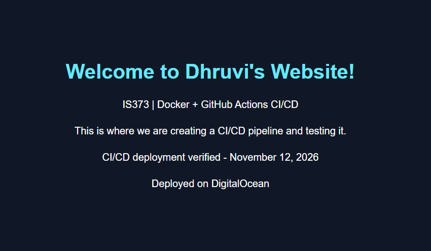
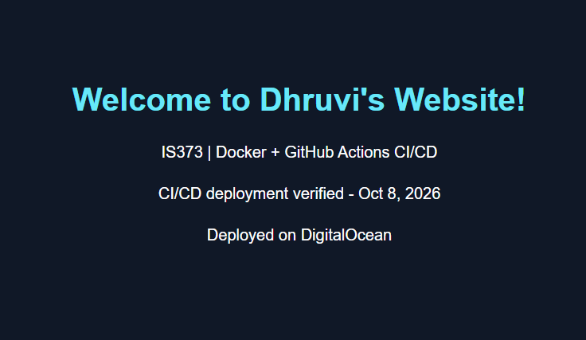
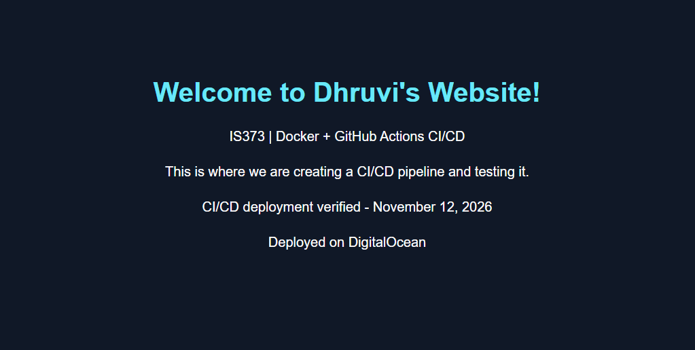

# IS373 Website — CI/CD Deployment

**Production:** https://dhruvi.live

**QA:** https://qa.dhruvi.live

## Overview
Containerized website deployed to DigitalOcean using Docker,
Traefik, HTTPS, and GitHub Actions.

## Deployment process
- Push to `qa` to test changes in QA.
- Merge `qa` into `main` to promote changes to production.
- GitHub Actions validates the website, builds and pushes
  a Docker image, and deploys it automatically.
- Failed validation or builds stop deployment.

## Security
- Non-root SSH deployment account
- SSH key authentication
- Root SSH login disabled
- Password SSH authentication disabled
- Deployment credentials stored in GitHub Actions Secrets

## Screenshots

- Successful SSH public-key authentication

- Non-root account and effective SSH settings

- QA test site screenshot with change

- Production site screenshot before merge

- Production site screenshot after merge 

## Test Evidence
- [Successful QA deployment](https://github.com/dhruvi0805/IS373_Website/actions/runs/43290041000) — `qa` branch, commit `9aa1d35`.
- [Successful production deployment](https://github.com/dhruvi0805/IS373_Website/actions/runs/43294044465) — `main` branch, commit `9aa1d35`.
- [Container registry — is373-website](https://github.com/users/dhruvi0805/packages/container/package/is373-website) — Production image: `ghcr.io/dhruvi0805/is373-website:main`.

### How deployment works

A push to `qa` triggers the QA deployment. Merging the tested change into `main` triggers the production deployment. GitHub Actions validates the website before building the Docker image from the repository’s Dockerfile, which copies `index.html` into an Nginx image. If validation or the build fails, deployment stops. On success, the workflow pushes the branch-tagged image to GitHub Container Registry and connects to the DigitalOcean Droplet over SSH to pull the image and update the corresponding Docker Compose service. QA and production run separately and are served at their own HTTPS hostnames.