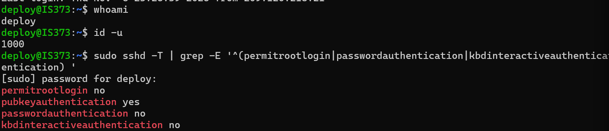
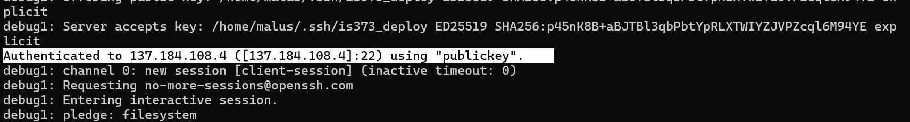

# IS373 Website — CI/CD Deployment

**Production:** https://dhruvi.live

**QA:** https://qa.dhruvi.live

## Overview
Containerized website deployed to DigitalOcean using Docker,
Traefik, HTTPS, and GitHub Actions.

## Deployment process
- Push to `qa` to test changes in QA.
- Merge `qa` into `main` to promote changes to production.
- GitHub Actions validates the website, builds and pushes
  a Docker image, and deploys it automatically.
- Failed validation or builds stop deployment.

## Security
- Non-root SSH deployment account
- SSH key authentication
- Root SSH login disabled
- Password SSH authentication disabled
- Deployment credentials stored in GitHub Actions Secrets

## Screenshots

- Successful SSH public-key authentication

- Non-root account and effective SSH settings

